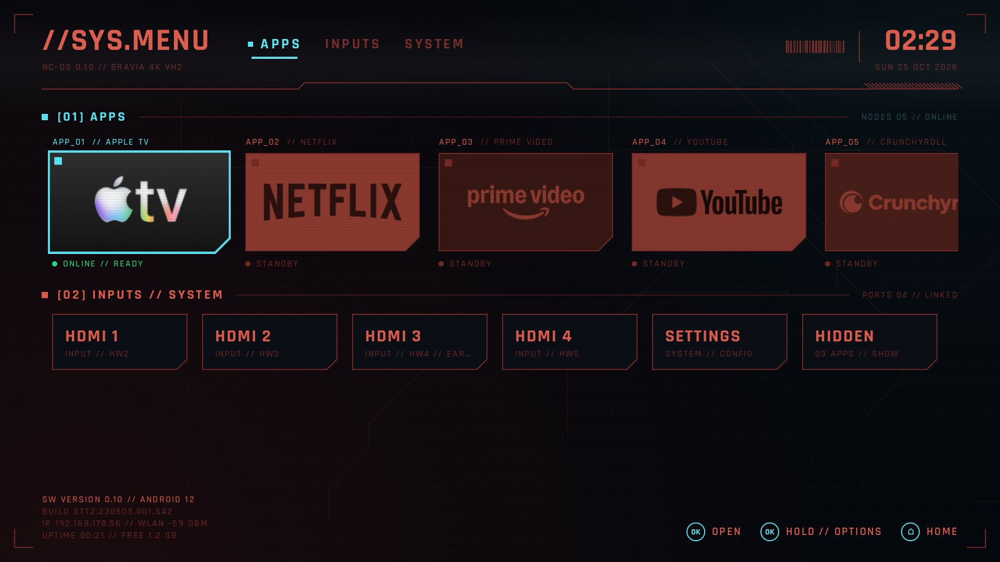
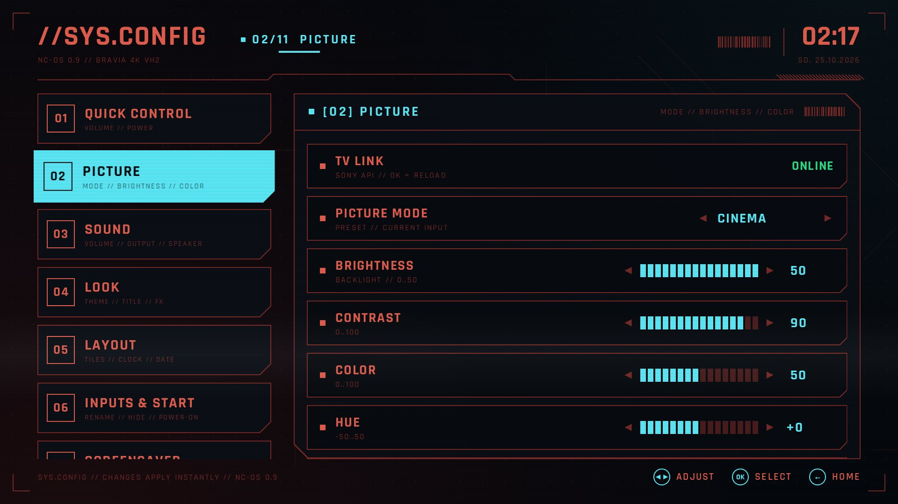
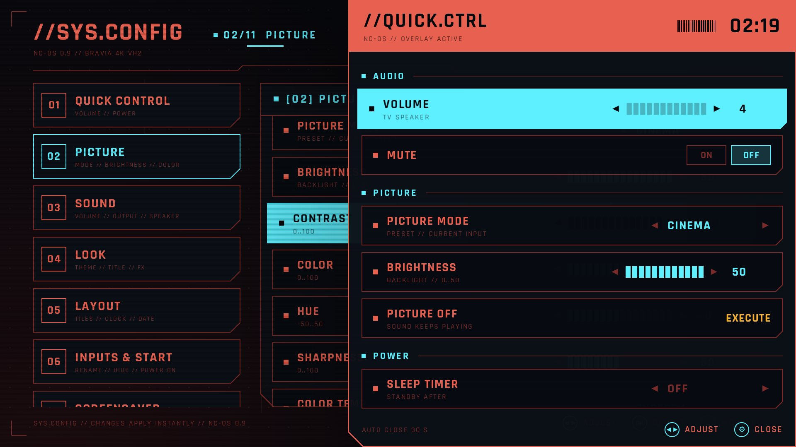

# NC-OS – eigener Launcher + Debloat für Sony BRAVIA (Google TV)

Ein selbst gebauter Startbildschirm im Look eines Cyberpunk-Spielmenüs, eigene Einstellungen für Bild, Ton,
WLAN & Co., ein eigenes Schnellmenü, eigene Bildschirmschoner und ein vorsichtiges, **komplett umkehrbares**
Debloat: kein Root, nichts wird gelöscht oder geflasht. Pakete werden nur ausgeschaltet (`pm disable-user`),
und jede Änderung wird vorher in `backups/state.tsv` notiert.

Gebaut und getestet auf einem **Sony KD-50X80J** (Plattform „BRAVIA 4K VH2“, Android 12, Google TV).
Andere BRAVIA-Modelle funktionieren wahrscheinlich ähnlich, die Debloat-Listen gelten aber nur für dieses Gerät
(siehe [Andere Modelle](#andere-modelle)).

> Nicht verbunden mit Sony, Google oder CD PROJEKT RED. Marken gehören ihren Inhabern, siehe [NOTICE.md](NOTICE.md).
> Benutzung auf eigene Gefahr – alles lässt sich aber per Skript oder Werksreset zurückdrehen.

| Startbildschirm | SYS.CONFIG › Picture | Schnellmenü (Zahnrad-Taste) |
|---|---|---|
|  |  |  |

## Was drin ist
- **Startbildschirm** `//SYS.MENU`: App-Kacheln (sortieren und ausblenden per langem OK), HDMI-Eingänge, Uhr,
  Wetter, Technik-Daten, Boot-Sequenz beim Einschalten, UI-Sounds und Glitch-Effekte.
- **SYS.CONFIG** (Kachel „Settings“), 14 Module:

  | Modul | Inhalt |
  |---|---|
  | 01 Quick Control | Lautstärke, Stumm, Schoner starten, Standby (zweimal OK) |
  | 02 Picture | Bildmodus, Helligkeit, Kontrast, Farbe, Farbton, Schärfe, Farbtemperatur, Lichtsensor, Local Dimming, HDR, Farbraum, **Picture Off** (Bild aus, Ton läuft) |
  | 03 Sound | Lautstärke, Stumm, Tonausgabe (TV / ARC / Audiosystem), TV-Position, aktive Ausgänge |
  | 04 Network | WLAN-Status, Signal, Band und Kanal, IP, Router, DNS, Antwortzeit-Test, Netze in der Nähe |
  | 05 Bluetooth | Gekoppelte Geräte mit Verbindungsstatus |
  | 06 Apps & Storage | Speicher belegt/frei, Größe jeder App, Sprung zur App-Info |
  | 07 Look | 5 Farbschemata (RED, AMBER, ACID, VIOLET, ICE), eigener Titel, Scanlines, Hintergrund, Logo-Tönung, Glitch-Stärke |
  | 08 Layout | Kachelgröße, Labels, Technik-Daten, 12/24 h, Datumsformat |
  | 09 Inputs & Start | HDMI umbenennen und ausblenden, Start-Ziel beim Einschalten (Eingang oder App) |
  | 10 Screensaver | Stil, Clip, Wechselzeit, Uhr-Overlay, Wartezeit, Vorschau |
  | 11 Launcher | UI-Sounds, Boot-Sequenz, Wetter-Ort, App-Reihenfolge, Backup Export/Import |
  | 12 Quick Menu | Schnellmenü an/aus, Taste anlernen, Inhalt wählen |
  | 13 TV System | Sprünge in die übrigen Android-/Sony-Seiten (Datum, Sprache, Bedienungshilfen …) |
  | 14 Status | Gerät, Android, Netzwerk, Speicher, Laufzeit, ausgeschaltete Pakete, Wetter |

  Bedienung: ◀ ▶ ändert Werte, OK wählt, Zurück springt aus dem Panel in die Modulliste.
- **Schnellmenü** `//QUICK.CTRL` statt Sonys Schnelleinstellungen: öffnet sich mit der Zahnrad-Taste über der
  laufenden App (Netflix, HDMI …). Inhalt: Lautstärke, Stumm, Bildmodus, Helligkeit, Picture Off, Sleep-Timer,
  Schoner, Standby, HDMI-Eingänge, Sprung zu SYS.CONFIG.
- **Bildschirmschoner**: WORLD CLOCK, CODE RAIN, NIGHT CITY, BREACH GRID (alle im Code gezeichnet),
  **VIDEO LOOP** (eigene Videos) und SHUFFLE (wechselt mit Glitch).

## Voraussetzungen
- Windows mit PowerShell 5.1 (vorinstalliert) oder 7.
- `adb` (Android Platform Tools), z. B. `winget install Google.PlatformTools`.
- Zum Bauen: JDK 17 oder neuer und das Android SDK (Platform 35). Gradle lädt den Rest selbst.
  Das SDK findet Gradle über `ANDROID_HOME` oder `sdk.dir=<Pfad>` in `launcher/local.properties`.
  Wenn Gradle das JDK nicht findet: `org.gradle.java.home=<Pfad>` in `%USERPROFILE%\.gradle\gradle.properties`.
- Am TV: Einstellungen → System → Info → 7× auf **Build** → Entwickleroptionen → **USB-Debugging an**.

## Schnellstart
```powershell
scripts\connect.ps1 <IP-des-TVs>           # am TV "Immer zulassen" bestätigen
scripts\inventory.ps1                      # liest nur, ändert nichts
launcher\gradlew.bat -p launcher assembleRelease
scripts\apply-all.ps1                      # Launcher als Startbildschirm + Debloat in 5er-Schritten + Prüfung
scripts\verify.ps1                         # prüft alles, auch nach einem Neustart
```
Optional danach:
```powershell
scripts\enable-sony-api.ps1                # Bild/Ton in SYS.CONFIG änderbar machen (siehe unten)
scripts\push-loops.ps1 "D:\Videos\loop.mp4"  # eigene Video-Loops für den Schoner
scripts\set-weather.ps1 Berlin             # Wetter-Ort (geht auch am TV)
```
Am Ende **USB-Debugging wieder ausschalten**: Netzwerk-ADB ist unverschlüsselt.

## Skripte
| Skript | Zweck |
|---|---|
| `connect.ps1` | WLAN-ADB verbinden (auch mit Kopplungscode), merkt die Adresse in `.device` |
| `inventory.ps1` | Bestandsaufnahme aller Pakete, Einstellungen und Komponenten, ändert nichts |
| `apply-all.ps1` | Alles in der richtigen Reihenfolge anwenden, bricht beim ersten Fehler ab |
| `debloat.ps1` | Eine Liste aus `debloat/` abarbeiten (`-Category`, `-Max`, `-DryRun`) |
| `install-launcher.ps1` | Launcher installieren, als Startbildschirm, Schoner und Schnellmenü setzen, Freigaben erteilen (`-NoHome`, `-NoScreensaver`, `-NoQuickPanel`) |
| `verify.ps1` | Zustand prüfen, ändert nichts |
| `restore.ps1` | Alles aus `state.tsv` zurückdrehen (`-RemoveLauncher` entfernt auch die App) |
| `remove-apps.ps1` | Selbst installierte Apps löschen, die nicht in `debloat/keep-apps.txt` stehen (APK-Sicherung vorher) |
| `hide-apps.ps1` | Apps im Launcher ausblenden (bleiben installiert) |
| `enable-sony-api.ps1` | Sonys Fernsteuer-API einschalten und den Schlüssel an den Launcher geben (`-Test`) |
| `push-loops.ps1` | Video-Loops auf den TV kopieren (`-List`, `-Remove`, `-Clear`) |
| `backup-launcher.ps1` | Launcher-Einstellungen sichern bzw. auf einen anderen TV bringen (`-Pull`, `-Push`) |
| `set-weather.ps1` | Wetter-Ort setzen (Open-Meteo, ohne Konto) |
| `make-sounds.ps1` | Die eigenen Standard-UI-Sounds neu erzeugen |

`debloat/keep-apps.txt` ist eine Beispiel-Liste (Apple TV, YouTube, Netflix, Prime Video, Crunchyroll) und
sollte vor `remove-apps.ps1` an die eigenen Apps angepasst werden. `remove-apps.ps1` ist bewusst nicht Teil
von `apply-all.ps1`.

## Bild und Ton über Sonys API
Bild- und Tonwerte von Sony kann eine normale App nur über Sonys eigene Fernsteuer-Schnittstelle ändern
(JSON-RPC auf Port 80, Paket `com.sony.dtv.webapi.core`).
1. `scripts\enable-sony-api.ps1` schaltet das Paket ein, erzeugt einen Schlüssel (in `backups/`, privat)
   und gibt ihn an den Launcher. Die API startet erst nach einem TV-Neustart.
2. Einmalig am TV: Einstellungen → Netzwerk & Internet → Heimnetzwerk → IP-Steuerung →
   Authentifizierung „Normal und vorinstallierter Schlüssel“, dann den Schlüssel eintragen.
3. `scripts\enable-sony-api.ps1 -Test` meldet „Schlüssel gilt“.

Lesen geht ohne Schlüssel, Ändern nur mit. Nebenwirkung: DIAL („Auf TV abspielen“ aus Handy-Apps) ist dann wieder
aktiv. Ohne diesen Schritt zeigen 02 Picture und 03 Sound die Werte nur an.

## UI-Sounds
Beim Bauen landen die Sounds aus `sounds/default/` in der App: eigene, per `scripts/make-sounds.ps1` errechnete
Töne, frei verwendbar. Jede gleichnamige Datei in **`sounds/custom/`** ersetzt den Standard-Sound. Dieser Ordner
ist privat und nicht im Repo. Details: [sounds/README.md](sounds/README.md).

## Video-Loops
Stil **VIDEO LOOP** spielt eigene Clips endlos (ExoPlayer, nahtlose Schleife), darüber Uhr, Scanlines und Glitch.
Die Clips gehören nicht ins Repo und nicht in die App: `scripts\push-loops.ps1 <Datei|Ordner>` kopiert sie in den
App-Ordner auf dem TV und lässt mindestens 600 MB frei. H.264/HEVC/VP9/AV1 bis 4K60 laufen, 1080p reicht.

## Zurücksetzen
**Stufe 1 – alles rückgängig, Apps und Konten bleiben:**
```powershell
scripts\restore.ps1                   # eigener Launcher bleibt drauf
scripts\restore.ps1 -RemoveLauncher   # auch den Launcher entfernen
```
Das schaltet die Pakete wieder ein, stellt Einstellungen und den alten Startbildschirm her und nimmt alle
Freigaben zurück. Sonys IP-Steuerung bleibt an (dafür gibt es keine Schnittstelle).

**Stufe 2 – zum Verkaufen (Originalzustand):** optional erst Stufe 1, dann am TV
Einstellungen → System → Info → Zurücksetzen → **Auf Werkseinstellungen zurücksetzen**. Da nichts gelöscht
oder geflasht wurde, ist danach alles wieder original.

**Notfall:** Power-Taste der Fernbedienung ca. 5 s halten (Neustart), dann `scripts\connect.ps1 <IP>` und
`scripts\restore.ps1`.

## Andere Modelle
Die Listen in `debloat/` stammen aus der Bestandsaufnahme eines KD-50X80J. Auf anderen Geräten zuerst
`scripts\inventory.ps1` laufen lassen, die Listen prüfen und mit `debloat.ps1 -DryRun` testen.
`debloat/never-touch.txt` schützt Pakete, ohne die der TV nicht läuft (Tuner, HDMI, WLAN, Fernbedienung …).

## Für Entwickler
- Aufbau und Eigenheiten des TVs: [docs/TECHNIK.md](docs/TECHNIK.md), Versionen: [docs/CHANGELOG.md](docs/CHANGELOG.md).
- Eigener Paketname (z. B. für eine zweite Installation): `ncos.applicationId=…` in `launcher/gradle.properties`.
  Die Skripte lesen ihn mit.
- Release-Signatur: `launcher/keystore.properties` mit `storeFile`, `storePassword`, `keyAlias`, `keyPassword`
  (nicht im Repo). Ohne die Datei wird mit dem lokalen Debug-Schlüssel signiert.

## Lizenz
Code und die Standard-Sounds: [MIT](LICENSE). Schrift Rajdhani: SIL OFL 1.1. Weitere Hinweise und Marken:
[NOTICE.md](NOTICE.md).
